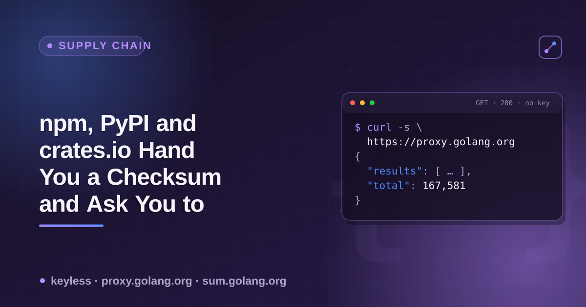

# package-checksum-transparency



npm, PyPI and crates.io each give you a checksum for a package version. None
of them give you a way to independently prove that checksum hasn't quietly
changed since the first time anyone recorded it. Go's module system does,
by default, for almost every public module. This is the reference sheet for
the difference — exact endpoints, what each one actually guarantees, and
what it doesn't.

## The check, per ecosystem

| Ecosystem | Endpoint | Field | What it proves |
|---|---|---|---|
| npm | `GET https://registry.npmjs.org/{name}/latest` | `dist.integrity` (sha512) + `dist.signatures[]` | A hash in metadata, signed by npm's own key — proves the registry vouches for it, not that an outside party recorded it independently |
| PyPI | `GET https://pypi.org/pypi/{name}/json` → `urls[].digests` | `sha256`, `md5`, `blake2b_256` per file | A hash in metadata, no independent log of any kind |
| crates.io | `GET https://index.crates.io/{shard}/{name}` (sparse index) | `cksum` | A hash in metadata, no independent log |
| **Go** | `GET https://sum.golang.org/lookup/{module}@{version}` | signed Merkle-tree leaf + tree head | A hash **and** cryptographic proof it's been publicly, immutably recorded in an append-only log since it was first seen — same primitive family as Certificate Transparency |

npm also has an opt-in, Sigstore-backed alternative (`dist.attestations`,
covered in a [prior piece](https://github.com/noble-ronin/package-provenance-data))
that *is* backed by a public transparency log (Rekor) — but it's opt-in, and
sampling found only 13/25 packages carry it. Go's checksum database isn't
opt-in on either side; it's the default path for nearly every `go get`.

## Live examples (checked 2026-11-02)

```bash
# Go module proxy — version list, latest, per-version metadata, all keyless
curl -s https://proxy.golang.org/github.com/gin-gonic/gin/@v/list
curl -s https://proxy.golang.org/github.com/gin-gonic/gin/@latest
curl -s https://proxy.golang.org/github.com/gin-gonic/gin/@v/v1.10.0.info
curl -s https://proxy.golang.org/github.com/gin-gonic/gin/@v/v1.10.0.mod

# Go checksum transparency log — a signed, numbered Merkle-tree entry
curl -s https://sum.golang.org/lookup/github.com/pkg/errors@v0.9.1
# 706716
# github.com/pkg/errors v0.9.1 h1:FEBLx1zS214owpjy7qsBeixbURkuhQAwrK5UwLGTwt4=
# github.com/pkg/errors v0.9.1/go.mod h1:bwawxfHBFNV+L2hUp1rHADufV3IMtnDRdf1r5NINEl0=
#
# go.sum database tree
# 70611205
# 5cw0ytqATKnxM/4FQGmo/Ms6tnLTfMJ763dbZGHhDKw=
#
# — sum.golang.org Az3grkR9...

# npm — one hash, signed, no independent log
curl -s https://registry.npmjs.org/left-pad/latest | python3 -c \
  "import json,sys; d=json.load(sys.stdin)['dist']; print(d['integrity']); print(d['signatures'])"

# PyPI — three hash algorithms, no log
curl -s https://pypi.org/pypi/requests/json | python3 -c \
  "import json,sys; print(json.load(sys.stdin)['urls'][0]['digests'])"

# crates.io — one hash, no log
curl -s https://index.crates.io/se/rd/serde | tail -c 300
```

## A quick self-check script

```bash
#!/usr/bin/env bash
# usage: ./check-go-sumdb.sh <module-path> <version>
# e.g. ./check-go-sumdb.sh github.com/pkg/errors v0.9.1
mod="$1"; ver="$2"
curl -s "https://sum.golang.org/lookup/${mod}@${ver}"
echo
echo "Compare the 'h1:' hash above to what 'go mod download' records in your"
echo "own go.sum for the same module@version — a mismatch is exactly what"
echo "GOSUMDB is designed to catch before your build ever uses the code."
```

## Mutability contrast — this is the part that actually matters

| Ecosystem | Can a published version's content change after the fact? |
|---|---|
| npm | Yes — unpublish within 72h, or anytime with no dependents; the version slot can later be reused |
| PyPI | Yes — delete is final and all-or-nothing, no per-version flag |
| crates.io | Yes — `yanked: true`, but a version removed as outright malware can be fully absent rather than yanked |
| **Go** | **No** — once a version's hash is signed into the public sumdb log, a later attempt to serve different content under the same module@version fails the client-side hash check. The only forward option is `retract` in `go.mod`, which flags a version as not-to-use; it doesn't erase or rewrite the log entry for what was actually published. |

This is the practical payoff of the transparency-log model: the previous four
pieces in this series on npm/PyPI/crates.io (removed versions, provenance,
"latest" semantics, maintainer emails) each found a different way a
registry's own metadata can go quiet about something that happened. Go's
model doesn't let the record go quiet — it can only grow.

## What this isn't

- `GOSUMDB=off`, `GOPRIVATE`, and a few flags disable the check entirely —
  it's a strong default, not an unbypassable guarantee.
- This repo does not claim to have demonstrated a tamper attempt being
  caught live; it documents the mechanism and shows the real log entries it
  produces for ordinary, legitimate modules.
- `rekor.sigstore.dev` (the log behind npm's own opt-in attestations) was
  unreachable from the environment this was checked in — that comparison
  leans on an earlier, separately-verified finding, not a fresh fetch.

## Why this actor

[`package-registry-scraper`](https://apify.com/ponderable_hydrometer/package-registry-scraper)
normalizes npm, PyPI and crates.io into one output shape — name, version,
license, repository, dependency count. It does not fetch Go module data;
this repo exists because comparing *outside* those three registries is what
surfaced the gap this time.

## Related

- [`package-provenance-data`](https://github.com/noble-ronin/package-provenance-data) — npm's opt-in, Sigstore-backed build provenance.
- [`package-removed-versions`](https://github.com/noble-ronin/package-removed-versions) — how each registry's metadata goes quiet about a bad version.
- Pairs with the dev.to article: [npm, PyPI and crates.io Hand You a Checksum and Ask You to Trust It. Go Doesn't Ask.](https://dev.to/ronin13/npm-pypi-and-cratesio-hand-you-a-checksum-and-ask-you-to-trust-it-go-doesnt-ask)
